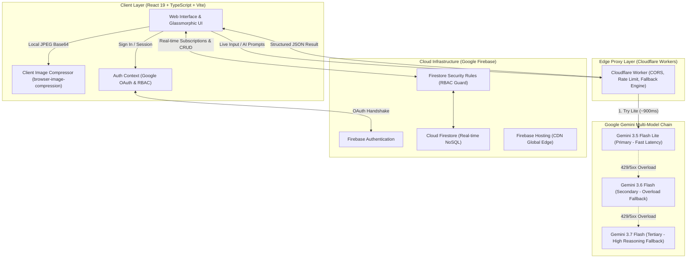
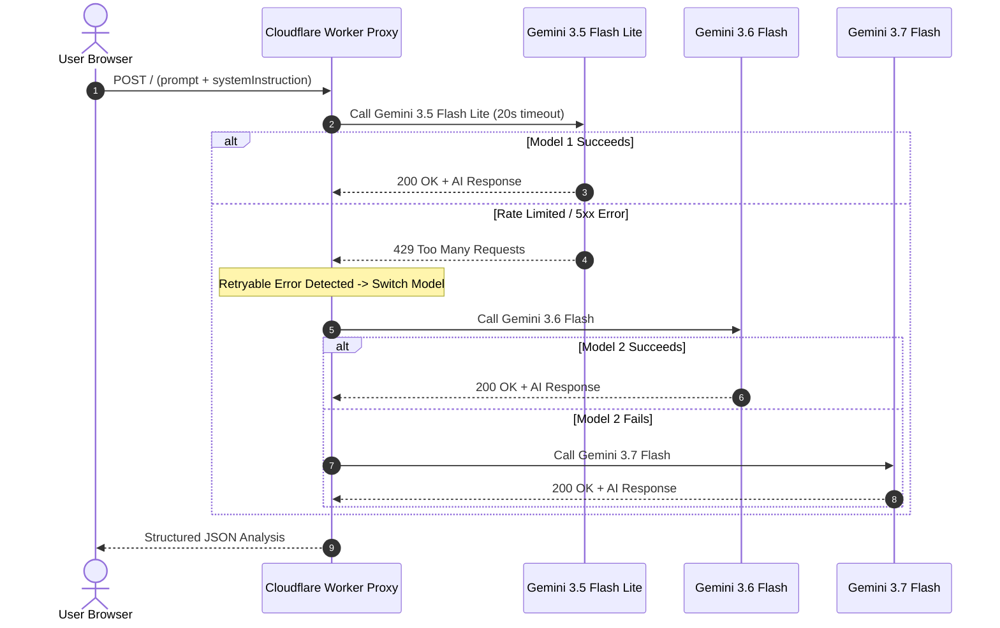
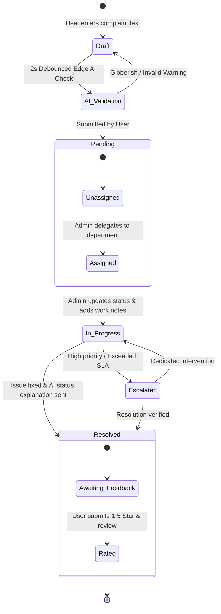

# 🗳️ Smart Complaint Box

<div align="center">

[](https://smart-complaint-box-2025.web.app)
[](https://react.dev/)
[](https://www.typescriptlang.org/)
[](https://firebase.google.com/)
[](https://workers.cloudflare.com/)
[](https://ai.google.dev/)
[](https://tailwindcss.com/)
[](https://vitejs.dev/)
[](LICENSE)

<br />

**An AI-Powered, Real-Time Complaint Resolution & Community Petition System.**  
Engineered for modern campuses, residential societies, and institutional facilities to eliminate administrative friction and streamline grievance workflows with generative AI.

[Explore Live Demo](https://smart-complaint-box-2025.web.app) • [Report Bug](https://github.com/naseem2917/Smart-Complaint-Box/issues) • [Request Feature](https://github.com/naseem2917/Smart-Complaint-Box/issues)

</div>

---

## 📑 Table of Contents

- [Overview](#-overview)
- [Key Features](#-key-features)
  - [🤖 AI Intelligence & Automation](#-ai-intelligence--automation)
  - [👥 Community Petitions & "Dhamaka" Engine](#-community-petitions--dhamaka-engine)
  - [🛡️ Role-Based Admin Command Center](#️-role-based-admin-command-center)
  - [👤 Citizen & Student Experience](#-citizen--student-experience)
  - [⚡ Zero-Bucket Image Compression Pipeline](#-zero-bucket-image-compression-pipeline)
  - [🎨 Modern Glassmorphic UI & Themes](#-modern-glassmorphic-ui--themes)
- [System Architecture](#-system-architecture)
  - [High-Level Data Flow](#high-level-data-flow)
  - [AI Edge Fallback Pipeline](#ai-edge-fallback-pipeline)
  - [Complaint Resolution Lifecycle](#complaint-resolution-lifecycle)
- [Tech Stack](#-tech-stack)
- [Database & Security Model](#-database--security-model)
- [Getting Started](#-getting-started)
  - [Prerequisites](#prerequisites)
  - [Installation](#installation)
  - [Environment Configuration](#environment-configuration)
  - [Firebase Configuration & Security Rules](#firebase-configuration--security-rules)
  - [Cloudflare Worker Setup (AI Proxy)](#cloudflare-worker-setup-ai-proxy)
- [Admin Access & RBAC](#-admin-access--rbac)
- [Project Directory Structure](#-project-directory-structure)
- [Available Scripts](#-available-scripts)
- [Production Deployment](#-production-deployment)
- [Roadmap](#-roadmap)
- [Contributing](#-contributing)
- [License](#-license)
- [Authors & Core Team](#-authors--core-team)

---

## 🌟 Overview

Traditional grievance mechanisms in colleges, universities, and organizations suffer from lack of transparency, manual prioritization bottlenecks, spam complaints, and missing community feedback.

**Smart Complaint Box** redefines grievance handling by combining:
1. **Real-time Edge AI validation:** Analyzes typing input with debounced AI to instantly filter gibberish, categorize grievances, score urgency, and suggest photographic evidence.
2. **Community-driven Petitions:** Enables students and residents to rally collective support. Petitions crossing 10 verified signatures earn the high-visibility **💥 Dhamaka Badge**, prompting priority administrative intervention.
3. **Enterprise-grade Admin Operations:** Complete lifecycle control with automated response generation, assignment tracking, internal notes, category customization, user management, and real-time Recharts analytics.
4. **Zero-Bucket Serverless Economics:** Ultra-efficient client-side JPEG compression stores evidence images as Base64 within Firestore documents, saving cloud storage subscription overhead.

---

## ✨ Key Features

### 🤖 AI Intelligence & Automation
- **Real-Time Input Validation:** As the user drafts a complaint, an intelligent 2-second debouncer queries edge AI to detect spam, random keystrokes, and gibberish.
- **Auto-Categorization & Urgency Scoring:** Evaluates text semantic intent to recommend appropriate category (e.g., *Water Supply, Electricity, Roads, Security*) and severity score (*Low, Medium, High, Critical*).
- **Automated Summary & Assignment Suggestion:** Distills long descriptions into 1–2 sentence executive summaries and pinpoints the relevant department for dispatch.
- **Dynamic Status Explanations:** Employs AI to generate empathetic, transparent explanations explaining the practical meaning of status updates to users.
- **Contextual AI Chatbot:** Interactive conversational assistant for users to query the status and resolution trajectory of their filed complaints.
- **Multi-Tone Email Drafter:** Admins can generate instant, tailored email responses with one click in three tones: **Strict**, **Friendly Follow-up**, or **Factual Report**.
- **Admin Hotspot & Trend Insights:** Analyzes complaint clusters across categories to detect institutional recurring bottlenecks.

### 👥 Community Petitions & "Dhamaka" Engine
- **7-Day Petition Lifecycle:** Users can initiate collective petitions with auto-expiring 7-day shareable web links.
- **One-Click Social Sharing:** Native WhatsApp and social sharing with pre-formatted invitation text.
- **Fraud-Resistant Signing:** Authenticated one-vote-per-user restriction enforced by client verification and Firestore security rules (creators cannot sign their own petitions).
- **💥 Dhamaka Priority Escalation:** Petitions achieving **10+ verified signatures** receive the animated **Dhamaka Badge**, signaling urgent administrative intervention.
- **Roster Transparency:** Administrators can inspect complete petition supporter rosters with verified names, emails, and signature timestamps.

### 🛡️ Role-Based Admin Command Center
- **Strict Role-Based Access Control (RBAC):** Fortified access powered by Super Admin email whitelisting and Firestore role enforcement with fallback denial screens.
- **Complaint Lifecycle Management:** Filter, search, inspect, and update grievance statuses (`Pending`, `In Progress`, `Resolved`, `Escalated`).
- **Internal Administrative Notes:** Secure audit thread for admin team members to document internal progress notes hidden from regular users.
- **Departmental Assignment:** Delegate specific tickets to authorized maintenance staff or department heads.
- **Dynamic Category Manager:** Add, modify, or retire categories complete with an icon selector of 30+ contextual emojis.
- **User Administration:** Inspect registered user directory, elevate users to administrator rank, or block malicious accounts.
- **Interactive Visual Analytics:** Visual breakdown of grievances by category, resolution velocity, satisfaction metrics, and timeline charts powered by Recharts.

### 👤 Citizen & Student Experience
- **Frictionless Authentication:** Google One-Click OAuth sign-in and email/password authentication.
- **Anonymous Submission Mode:** Option to submit sensitive grievances anonymously to protect user privacy.
- **Live Visual Audit Timeline:** Real-time chronological timeline tracking grievance events tagged by actor (`User`, `AI`, `Admin`, `System`).
- **Post-Resolution Rating & Feedback:** 1–5 star rating system and written feedback submission once a grievance is marked `Resolved`.
- **Personal Activity Reports:** Automated AI-generated summary reports evaluating user complaint history and resolution rates.

### ⚡ Zero-Bucket Image Compression Pipeline
- **In-Browser Image Optimization:** Powered by `browser-image-compression` to resize images on the client before network transmission (Max Width: 800px, JPEG format, 50% quality factor).
- **Zero Storage Cost Overhead:** Compressed images are stored directly as Base64 strings in Firestore documents, completely bypassing costly dedicated Cloud Storage bucket subscriptions.

### 🎨 Modern Glassmorphic UI & Themes
- **Adaptive Dark / Light Themes:** Fluid theme switcher with persistent local state and system-preference detection.
- **Micro-Animations:** Framer Motion transitions, reactive card hover effects, and spring animations.
- **Mobile-First Responsive Layout:** Glassmorphic layout designed for seamless operation on mobile, tablet, and desktop screens.

---

## 🏗️ System Architecture

### High-Level Data Flow



### AI Edge Fallback Pipeline

To ensure 99.9% availability and bypass transient rate limits without breaking user forms, the Cloudflare Worker implements an intelligent multi-model retry chain:



### Complaint Resolution Lifecycle



---

## 🛠️ Tech Stack

| Category | Technology | Version | Purpose / Architectural Role |
| :--- | :--- | :--- | :--- |
| **Frontend Framework** | [React](https://react.dev/) | `^19.2.0` | Declarative UI rendering & state management |
| **Type Safety** | [TypeScript](https://www.typescriptlang.org/) | `~5.9.3` | Strict compile-time typing & interfaces |
| **Build & Tooling** | [Vite](https://vitejs.dev/) | `^7.2.4` | Ultra-fast HMR and optimized production bundling |
| **Styling & Design** | [Tailwind CSS](https://tailwindcss.com/) | `^3.4.19` | Utility-first styling with custom dark theme system |
| **Animation Engine** | [Framer Motion](https://www.framer.com/motion/) | `^12.23.26` | Spring animations, layout shifts, micro-interactions |
| **Edge Proxy** | [Cloudflare Workers](https://workers.cloudflare.com/) | Edge | Serverless proxy handling API keys, CORS, & AI failovers |
| **Generative AI** | [Google Gemini Models](https://ai.google.dev/) | 3.5 / 3.6 / 3.7 | Live spam detection, categorization, summary, email drafting |
| **Authentication** | [Firebase Auth](https://firebase.google.com/) | `^12.6.0` | Google OAuth 2.0 & Email/Password session security |
| **Database** | [Cloud Firestore](https://firebase.google.com/) | `^12.6.0` | Real-time NoSQL document store with listener feeds |
| **Image Pipeline** | [browser-image-compression](https://www.npmjs.com/package/browser-image-compression) | `^2.0.2` | Client-side compression to JPEG Base64 (zero storage cost) |
| **Data Visualization** | [Recharts](https://recharts.org/) | `^3.6.0` | Interactive charts for grievance metrics and trends |
| **Iconography** | [Lucide React](https://lucide.dev/) | `^0.561.0` | Modern, consistent vector icons |
| **Date Formatting** | [date-fns](https://date-fns.org/) | `^4.1.0` | Robust human-readable date & time utilities |
| **Hosting** | [Firebase Hosting](https://firebase.google.com/docs/hosting) | Global CDN | Fast, cached worldwide distribution |

---

## 🔒 Database & Security Model

The system enforces strict, declarative Firestore Security Rules (`firestore.rules`) adhering to least-privilege principles:

```
┌────────────────────────────────────────────────────────────────────────┐
│                        FIRESTORE SCHEMA OVERVIEW                       │
├────────────────────────────────────────────────────────────────────────┤
│ • users/{userId}             -> Profile, display name, photo, role     │
│ • complaints/{complaintId}   -> Grievance records, AI analysis, notes  │
│ • groupComplaints/{id}       -> Petitions, supporters, Dhamaka status  │
│ • categories/{categoryId}    -> Custom grievance categories & icons    │
└────────────────────────────────────────────────────────────────────────┘
```

### Security Policy Matrix

| Collection | Action | Allowed For | Conditions & Verification |
| :--- | :--- | :--- | :--- |
| `users` | **Read** | Owner / Admin | Users can only inspect their own document; admins read all. |
| `users` | **Create** | Authenticated User | Allowed on signup; new user role is restricted to `'user'`. |
| `users` | **Update** | Owner / Admin | Users can edit `displayName` / `photoURL`; role promotion is admin-only. |
| `complaints` | **Read** | Owner / Admin | Regular users can read only their own tickets; admins read all. |
| `complaints` | **Create** | Authenticated User | Requires valid UID match (`request.resource.data.userId == auth.uid`). |
| `complaints` | **Update** | Owner (Feedback) / Admin | Users can only modify `userRating` / `userFeedback` on resolution. |
| `groupComplaints` | **Read** | Any Authenticated | Required to render petitions and public sign links. |
| `groupComplaints` | **Create** | Authenticated User | Requester is tagged as petition creator (`creatorId == auth.uid`). |
| `groupComplaints` | **Sign / Support** | Non-Creator User | Users can append signature; cannot overwrite title or status. |
| `categories` | **Read / Write** | Read: All / Write: Admin | Categories are publicly readable; creation & editing are admin-locked. |

---

## 🚀 Getting Started

### Prerequisites

Ensure the following tools are installed on your workstation:
- **Node.js**: `v18.x` or higher (Recommended: `v20+`)
- **Package Manager**: `npm` (v9+) or `yarn` / `pnpm`
- **Firebase Account**: Access to [Firebase Console](https://console.firebase.google.com)
- **Google AI Studio Key**: API Key from [Google AI Studio](https://aistudio.google.com/) *(for your Cloudflare Worker)*
- **Cloudflare Account**: *(Optional, only if self-hosting your AI edge worker)*

---

### Installation

```bash
# 1. Clone the repository
git clone https://github.com/naseem2917/Smart-Complaint-Box.git

# 2. Enter project directory
cd Smart-Complaint-Box/Smart-Complaint-Box

# 3. Install dependencies
npm install
```

---

### Environment Configuration

Create a `.env` file in the root of the React app (`Smart-Complaint-Box/`):

```env
# ── Firebase Client Configuration ─────────────────────────────────────
VITE_FIREBASE_API_KEY=your_firebase_api_key
VITE_FIREBASE_AUTH_DOMAIN=your_project_id.firebaseapp.com
VITE_FIREBASE_PROJECT_ID=your_project_id
VITE_FIREBASE_STORAGE_BUCKET=your_project_id.firebasestorage.app
VITE_FIREBASE_MESSAGING_SENDER_ID=your_messaging_sender_id
VITE_FIREBASE_APP_ID=your_app_id

# ── AI Proxy Configuration ───────────────────────────────────────────
# Default production edge worker is preconfigured in src/services/ai.ts
# To point to your self-hosted worker, update CLOUDFLARE_WORKER_URL
```

> [!NOTE]
> The repository already includes active pre-configured sandbox Firebase credentials for rapid testing in [src/services/firebase.ts](file:///c:/Smart-Complain-Box/Smart-Complaint-Box/src/services/firebase.ts). You can substitute them with your own Firebase project credentials at any time.

---

### Firebase Configuration & Security Rules

1. Visit the [Firebase Console](https://console.firebase.google.com) and create a new project.
2. Under **Build > Authentication**, enable the **Google** provider and **Email/Password** provider.
3. Under **Build > Firestore Database**, create a database instance in production mode.
4. Deploy the verified security rules:
   ```bash
   # Login to your Firebase CLI
   npx firebase-tools login

   # Deploy only Firestore security rules
   npm run deploy:rules
   ```

---

### Cloudflare Worker Setup (AI Proxy)

The frontend communicates with a Cloudflare Worker that proxies requests to Google Gemini. This hides your Google Gemini API key from client-side bundles and manages model fallbacks.

If you wish to deploy your own worker instance:

```bash
# 1. Navigate to the worker directory
cd worker

# 2. Install wrangler globally or run via npx
npm install -g wrangler

# 3. Authenticate with Cloudflare
wrangler login

# 4. Set your Google Gemini API Key as an encrypted secret
wrangler secret put GEMINI_API_KEY

# 5. Deploy to Cloudflare Edge
wrangler deploy
```

Once deployed, update `CLOUDFLARE_WORKER_URL` in [src/services/ai.ts](file:///c:/Smart-Complain-Box/Smart-Complaint-Box/src/services/ai.ts) with your worker's domain.

---

### Running Development Server

```bash
# Launch Vite development server with local network host access
npm run dev
```

Visit `http://localhost:5173` in your browser.

---

## 🔑 Admin Access & RBAC

Administrative privileges are enforced via a two-tier verification check:

1. **Super Admin Email Whitelist:**
   Defined in [src/config/constants.ts](file:///c:/Smart-Complain-Box/Smart-Complaint-Box/src/config/constants.ts):
   ```typescript
   export const SUPER_ADMIN_EMAIL = 'khannaseem1704@gmail.com';
   ```
   Users logged in with this email automatically receive Super Admin authorization. You can edit this constant to match your administrative Google account.

2. **Database Role Privileges:**
   Any user whose Firestore profile in the `users` collection contains `role: 'admin'` is granted administrative access. Existing admins can elevate other users directly from the **Admin > Users** management screen.

3. **Accessing the Portal:**
   Navigate to `/admin` in your browser. If authenticated with an authorized admin account, the portal renders immediately. Unauthorized access attempts are intercepted and routed to the secure `AdminAccessDenied` screen.

---

## 📁 Project Directory Structure

```text
Smart-Complaint-Box/
├── .firebase/                    # Firebase CLI configuration cache
├── .firebaserc                   # Firebase active project targets
├── firestore.rules               # Production-grade Firestore RBAC rules
├── firebase.json                 # Firebase Hosting & Firestore deployment spec
├── index.html                    # Single-page application entry HTML
├── package.json                  # Dependencies, scripts, and build configuration
├── postcss.config.js             # PostCSS plugins configuration
├── tailwind.config.js            # Tailwind typography, theme tokens & styling
├── tsconfig.json                 # TypeScript compiler configuration
├── vite.config.ts                # Vite build plugins & server host setup
│
├── worker/                       # Cloudflare Worker Edge AI Proxy
│   ├── index.js                  # Multi-model Gemini fallback engine & CORS handler
│   └── wrangler.toml             # Cloudflare Worker configuration & variables
│
├── public/                       # Favicons, icons, and static web assets
│
└── src/
    ├── main.tsx                  # React DOM root bootstrapping
    ├── App.tsx                   # Route hierarchy, AdminGate & AuthRequired guards
    ├── index.css                 # Base styles, Tailwind directives, dark mode tokens
    │
    ├── assets/                   # Vector SVGs, illustrations, and images
    │
    ├── config/                   # Global configuration
    │   └── constants.ts          # Super admin email & role helper functions
    │
    ├── context/                  # React State Context Providers
    │   ├── AuthContext.tsx       # Firebase session & role state management
    │   ├── NotificationContext.tsx# Centralized toast event dispatcher
    │   └── ThemeContext.tsx      # Dark / Light theme persistence controller
    │
    ├── components/
    │   ├── common/               # Design system reusable atoms
    │   │   ├── Button.tsx        # Framer Motion animated buttons
    │   │   ├── Card.tsx          # Glassmorphic surface containers
    │   │   ├── Input.tsx         # Styled input elements
    │   │   ├── Modal.tsx         # Accessible overlay modals
    │   │   ├── PriorityBadge.tsx # Priority indicators (Critical, High, Med, Low)
    │   │   ├── StatusBadge.tsx   # Status chips (Pending, In Progress, Resolved)
    │   │   ├── StarRating.tsx    # Interactive 5-star user feedback component
    │   │   ├── Textarea.tsx      # Adaptive text input
    │   │   └── ToastContainer.tsx# Global notification container
    │   └── layout/
    │       ├── Header.tsx        # Top navigation bar with theme & profile controls
    │       ├── Sidebar.tsx       # Role-aware responsive navigation sidebar
    │       ├── Layout.tsx        # Master layout wrapper
    │       └── Footer.tsx        # Footer with links & copyright
    │
    ├── pages/
    │   ├── AdminAccessDenied.tsx # Security fallback page for unauthorized users
    │   ├── AdminLoginRequired.tsx# Authentication prompt for guest admin access
    │   │
    │   ├── auth/                 # Authentication screens
    │   │   ├── LoginPage.tsx     # Google OAuth & Email login form
    │   │   ├── SignupPage.tsx    # User registration form
    │   │   └── ProfilePage.tsx   # User profile, photo, role badges & logout
    │   │
    │   ├── user/                 # User grievance portal
    │   │   ├── DashboardPage.tsx # User statistics overview & fast action cards
    │   │   ├── SubmitComplaintPage.tsx   # Real-time AI typing validation & submission
    │   │   ├── ComplaintDetailPage.tsx   # Timeline, AI summary, ratings & reviews
    │   │   ├── ComplaintHistoryPage.tsx  # Filterable grievance history
    │   │   ├── CreateGroupComplaintPage.tsx # Petition creation with 7-day expiry
    │   │   └── SignGroupComplaintPage.tsx   # Shared public petition signing link
    │   │
    │   └── admin/                # Administrative dashboard suite
    │       ├── AdminDashboardPage.tsx       # KPI metrics & grievance overview
    │       ├── ComplaintManagementPage.tsx  # Kanban-style grievance management
    │       ├── AdminComplaintDetailPage.tsx # Ticket deep-dive, assignments & notes
    │       ├── AdminGroupComplaintsPage.tsx # Petition tracker & Dhamaka roster
    │       ├── AdminCategoriesPage.tsx      # Category builder with 30+ emoji picker
    │       ├── AdminUsersPage.tsx           # User roster & role promotion
    │       ├── AdminAIInsightsPage.tsx      # Institutional hotspot & trend analysis
    │       ├── AnalyticsPage.tsx            # Recharts graphical visual reports
    │       ├── AdminNotificationsPage.tsx   # Broadcast alert center
    │       └── AdminSettingsPage.tsx        # Administrative system settings
    │
    ├── services/                 # External service integrations
    │   ├── firebase.ts           # Firebase SDK initialization & auth providers
    │   ├── auth.ts               # Sign-in, sign-up, Google OAuth & user lookup
    │   ├── complaints.ts         # Firestore CRUD for individual complaints
    │   ├── groupComplaints.ts    # Firestore petition queries & signature transactions
    │   ├── categories.ts         # Category management Firestore service
    │   ├── users.ts              # User administration & role mutation service
    │   └── ai.ts                 # Gemini API integration via Cloudflare Edge Worker
    │
    ├── types/                    # TypeScript interfaces & domain models
    │   └── index.ts              # Complaint, User, Petition, AI & Timeline schemas
    │
    └── utils/                    # Utility helpers
        └── imageCompressor.ts    # Client-side image canvas compression helper
```

---

## 📜 Available Scripts

In the project root, you can execute:

| Command | Action |
| :--- | :--- |
| `npm run dev` | Runs Vite development server on `localhost:5173` with network exposure (`--host`). |
| `npm run build` | Compiles TypeScript (`tsc -b`) and bundles an optimized production build into `dist/`. |
| `npm run preview` | Locally serves the production `dist/` directory for release validation. |
| `npm run lint` | Runs ESLint across the codebase to catch style and syntax discrepancies. |
| `npm run deploy` | Builds the project and deploys both **Hosting** and **Firestore Rules** to Firebase. |
| `npm run deploy:rules`| Deploys only `firestore.rules` to Cloud Firestore without building frontend bundles. |

---

## 🚢 Production Deployment

### 1. Build and Deploy Frontend (Firebase Hosting)

Deploy the single-page application and security rules to Firebase Hosting:

```bash
# Ensure you are logged into Firebase
npx firebase-tools login

# Build production bundle and deploy
npm run deploy
```

Your web application will be live at:
```
https://<YOUR_FIREBASE_PROJECT_ID>.web.app
https://<YOUR_FIREBASE_PROJECT_ID>.firebaseapp.com
```

### 2. Deploy AI Edge Worker (Cloudflare)

```bash
cd worker
npx wrangler secret put GEMINI_API_KEY
npx wrangler deploy
```

---

## 🗺️ Roadmap

- [x] Real-time debounced AI live analysis (spam & gibberish detection)
- [x] Multi-model Gemini fallback chain on Cloudflare Workers
- [x] Zero-storage-bucket client-side Base64 image compression
- [x] Group Petitions system with 7-day expiry and 💥 Dhamaka badge
- [x] Role-Based Admin Panel with Recharts visual analytics
- [x] Interactive user satisfaction rating & feedback submission
- [ ] **Push & In-App Notifications:** Real-time push updates via Firebase Cloud Messaging (FCM).
- [ ] **WhatsApp Bot Webhook:** Allow users to lodge complaints directly via a WhatsApp conversational agent.
- [ ] **Geolocation Pinning:** Interactive campus/community map tagging exact incident coordinates.
- [ ] **Automated SLA Timers:** Auto-escalation triggers if High/Critical issues remain unaddressed past predefined hours.

---

## 🤝 Contributing

Contributions make the open-source community an inspiring place to learn, inspire, and create. Any contributions you make are **greatly appreciated**.

1. **Fork the Project**
2. **Create your Feature Branch:**
   ```bash
   git checkout -b feature/AmazingFeature
   ```
3. **Commit your Changes:**
   ```bash
   git commit -m 'feat: Add some AmazingFeature'
   ```
4. **Push to the Branch:**
   ```bash
   git push origin feature/AmazingFeature
   ```
5. **Open a Pull Request**

---

## 📄 License

Distributed under the **MIT License**. See `LICENSE` for more information.

---

## 👥 Authors & Core Team

Developed with passion by:

<div align="center">

| Avatar | Name | Role | GitHub |
| :---: | :--- | :--- | :---: |
|  | **Naseem Khan** | Full Stack Engineer & Cloud Architect | [@Naseem2917](https://github.com/Naseem2917/) |
|  | **Ankit Shrivastava** | Frontend Developer & UI/UX Specialist | [@shrivastavaankit-2006](https://github.com/shrivastavaankit-2006/) |
|  | **Shani Sharma** | Frontend Developer & Systems Integration | [@shani0136](https://github.com/shani0136/) |

<br />

⭐ **If you found this project helpful, please give it a star on [GitHub](https://github.com/naseem2917/Smart-Complaint-Box)!**

</div>
